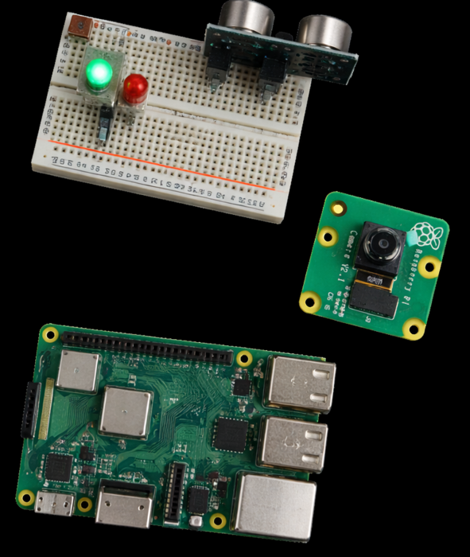

# 🚨 Raspberry Pi Security System


A home alarm built with a Raspberry Pi. An ultrasonic sensor detects movement, the Pi sounds a buzzer and records a photo and a 10-second video with the camera module, and the alert arrives on your phone through **Discord**.


<sub>Real photo of the build, edited with AI to remove the jumper wires so the components are easier to see.</sub>

## How it works

1. Press **Play** on the IR remote to arm the system: the status LED turns on and the current distance in front of the sensor becomes the reference.
2. The HC-SR04 sensor measures the distance about once a second. When something comes more than **3 cm closer** than the reference, the alarm goes off:
   - the buzzer sounds for 1 second;
   - the camera takes a 1280×720 photo and records 10 seconds of video, converted from `.h264` to `.mp4` with `ffmpeg`;
   - a Discord webhook posts the time, the distance change, the photo and the video.
3. Videos over Discord's 8 MB limit aren't uploaded. The alert carries a link to a small **Flask** server on the Pi that streams them on the local network, protected by a password.
4. Press **Play** again to disarm. Every alarm is written to `recordings/alarm_log.txt`.

Some implementation details:

- **IR decoding by hand:** the remote's NEC signal is read directly from the GPIO pin by timing the pulses, without LIRC or any IR library.
- **Threads:** the remote and the sensor run in two threads, so the system can be armed or disarmed while it is measuring.
- **One launcher:** `start_all.py` starts the detector and the video server together and merges their output.

## Hardware

- Raspberry Pi with a camera port, plus the Raspberry Pi Camera Module
- HC-SR04 ultrasonic distance sensor (with a voltage divider on ECHO: it outputs 5 V and the Pi's GPIO expects 3.3 V)
- IR receiver and an NEC remote
- Active buzzer
- LED with a resistor
- Breadboard and jumper wires

## Wiring (physical pin numbers, `GPIO.BOARD`)

| Pin | Connected to |
| --- | --- |
| 7 | Buzzer |
| 13 | IR receiver OUT |
| 15 | Status LED |
| 16 | HC-SR04 TRIG |
| 18 | HC-SR04 ECHO |

## Setup

The camera code uses the `picamera` library, which needs the **legacy camera stack** (Raspberry Pi OS Buster, or Bullseye with *Legacy Camera* enabled in `raspi-config`).

```bash
sudo apt update
sudo apt install ffmpeg python3-pip python3-picamera
pip3 install RPi.GPIO requests python-dotenv flask

git clone https://github.com/MCCProgrammer/RaspberryPi-Security-System.git
cd RaspberryPi-Security-System
cp .env.example .env
```

Fill in `.env`:

| Variable | Description |
| --- | --- |
| `DISCORD_WEBHOOK_URL` | Webhook of the Discord channel that receives the alerts (*Channel settings → Integrations → Webhooks*) |
| `WEB_PASSWORD` | Password for the video links. The video server won't start without it |

## Running it

```bash
python3 start_all.py
```

Wait a couple of seconds, point the remote at the receiver and press **Play**. The terminal shows the distance readings and every alert sent.

The remote codes are in the `Buttons` list in `securitySystemDiscord.py`. Only `ButtonPlay` is used: change it there if your remote sends a different code.

## Files

| File | Purpose |
| --- | --- |
| `start_all.py` | Starts both programs and prefixes their output with `[Motion]` and `[Flask]` |
| `securitySystemDiscord.py` | IR decoding, distance measurement, buzzer, camera, Discord alerts and the log |
| `recordings/video_server.py` | Flask server that lists and serves the recorded `.mp4` videos |
